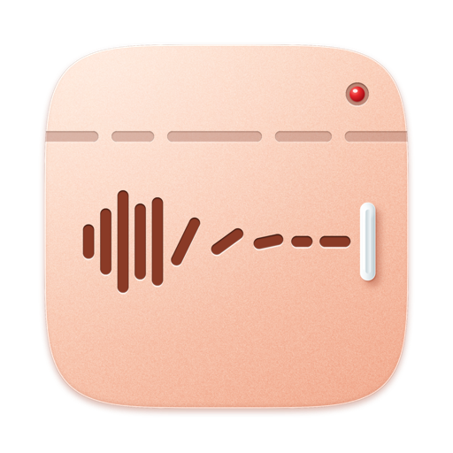
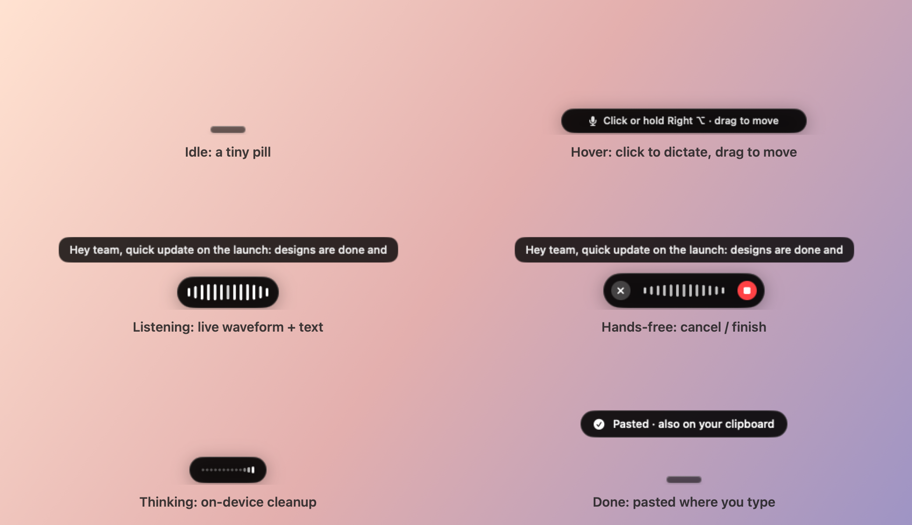

<p align="center">
  
</p>

<h1 align="center">Yap</h1>

<p align="center">
  <b>Talk instead of typing. Record instead of explaining.</b><br>
  Voice dictation and screen recording for macOS, in one tiny native app. 100% on-device, free and open source.
</p>

<p align="center">
  
</p>

---

## Why

Most dictation and screen-recording tools are hundreds of megabytes of web runtime, send your voice to a server,
and want a subscription. Yap is a few megabytes of Swift. Speech recognition, cleanup and summaries all run on your
Mac using Apple's on-device models, with optional open-weight models you choose and download yourself.

- **No account, no cloud, no telemetry.** Nothing leaves your Mac unless you point Yap at a server yourself.
- **Small and fast.** Native SwiftUI/AppKit, ~70 MB of memory, 0% CPU when idle.
- **Your files.** Recordings are plain `.mp4` files with `.srt` captions and JSON notes, in a folder you choose.

## Features

### Dictate anywhere
- **Hold a key and talk**; release to paste at your cursor. **Double-tap** for hands-free; press again to finish. **Esc** cancels.
- **Any key you like.** Record your own shortcut: Fn, Right Alt, Right Ctrl, F13, ⌃Space… Windows and 60% keyboards are detected, with sensible suggestions.
- **AI cleanup:** removes "um"s and false starts, applies self-corrections ("at 3, no wait, 4" → "at 4"), formats lists, and adapts to the app you're typing in.
- **Command Mode:** select text, hold your Command Mode key, and say "make this friendlier". With nothing selected it writes new text.
- **Dictionary and snippets:** teach spellings (`chat gpt => ChatGPT`) and voice shortcuts (`my calendar link => https://…`).
- Pastes at your cursor **and** leaves the text on your clipboard, so it's never lost. Searchable history and a words-dictated counter.

### Record your screen
- **⌥⇧R** records the display under your pointer, or pick a window or app with the system picker.
- Draggable **camera bubble** (iPhone via Continuity Camera, USB webcams, capture cards), mic and optional system audio, click highlights, 3-2-1 countdown.
- **No time limit.** When you stop, the video is copied to your clipboard; paste it straight into Slack, Mail or an issue.
- On-device **transcript, captions, AI title, summary and chapters** for every recording. Built-in trim.

### The Flow bar
A small pill that lives at the bottom of your screen. It shows a live waveform and your words as you talk, and the
controls in hands-free mode. Click it to dictate, drag it anywhere. It never steals focus and respects Reduce Motion.

### The mark
Yap's logo is a ball with three rings sliding inside it. It's drawn live, not from images, and moves with what Yap is
doing: it rolls in at startup, rests in the menu bar, flows faster the louder you talk, loops while generating, does
one quick roll when your text lands, and pulses red while recording. Timing and shape come from a tuning tool
(`design/mark/lab.html`) and live in `design/mark/mark-config.json`.

### Models (Settings → Models)
| Job | Default | Optional |
|---|---|---|
| Speech → text | Apple Speech (built-in, on-device) | **Whisper** via [WhisperKit](https://github.com/argmaxinc/WhisperKit): tiny (~75 MB) to large-v3 (~1.6 GB), one-click download, or type any model name |
| Cleanup, Command Mode, summaries | Apple Intelligence (on-device) | A **second model** via [Ollama](https://ollama.com) (one-click pulls) or any OpenAI-compatible server (LM Studio, llama.cpp, Groq, OpenRouter…) |

Route each job to Apple or the second model, e.g. Apple for instant cleanup and a bigger model for Command Mode.
If the second model is slow or offline, Apple Intelligence finishes the job automatically.

## Requirements
- macOS 26 or later on Apple Silicon
- Apple Intelligence enabled for AI cleanup and Command Mode (without it, Yap falls back to rule-based cleanup)
- A microphone (built-in, USB, Bluetooth or an iPhone via Continuity Camera)

## Install (build from source)

Xcode is **not** required; the Command Line Tools are enough (`xcode-select --install`).

```bash
git clone https://github.com/max-pantom/yap.git
cd yap
./build.sh --install
open /Applications/Yap.app
```

`./build.sh` alone builds `build/Yap.app` without installing. With Xcode 26 installed, the build also compiles the
Liquid Glass app icon (`Resources/AppIcon.icon`, made in Icon Composer) so it adapts to light, dark, tinted and clear
modes; with only the Command Line Tools it uses a static render of the same icon. The app is ad-hoc signed; the build pins its code
requirement to the bundle identifier, so macOS privacy permissions survive rebuilds.

### Permissions
On first launch Yap walks you through these (Settings → Permissions shows their status any time):

| Permission | Why |
|---|---|
| Microphone | Hear you while you dictate or narrate |
| Input Monitoring | Notice your dictation key (Yap only *listens*; it never blocks or changes your typing) |
| Accessibility | Paste at your cursor and read selected text for Command Mode |
| Screen & System Audio Recording | Record your screen, only while you're recording |
| Camera (optional) | The camera bubble |

## Privacy

Everything runs locally. Yap stores:

| What | Where |
|---|---|
| Recordings, captions (`.srt`), notes (`.yap.json`) | `~/Movies/Yap` (configurable) |
| Dictation history | `~/Library/Application Support/Yap/history.json` |
| Downloaded Whisper models | `~/Library/Application Support/Yap/Models` |
| Diagnostic log (events and timings, never what you said) | `~/Library/Logs/Yap.log` |
| API key for a custom server, if you add one | macOS Keychain |

The only network traffic is what you ask for: downloading a model, or sending text to a second model you configured.
Settings warns you when that model isn't on your Mac.

## Contributing

Issues and pull requests are welcome. See [CONTRIBUTING.md](CONTRIBUTING.md) for the code layout and built-in
debug tools (pipeline self-tests, a slow-motion animation demo, device listing).

## Credits
- [WhisperKit](https://github.com/argmaxinc/WhisperKit) by Argmax (MIT) for on-device Whisper
- Apple's Speech, FoundationModels, ScreenCaptureKit and AVFoundation frameworks
- Motion principles from Emil Kowalski's animation writing

## License

[MIT](LICENSE). Yap is an independent project and is not affiliated with or endorsed by Apple or any other company
whose products are mentioned or used here.
